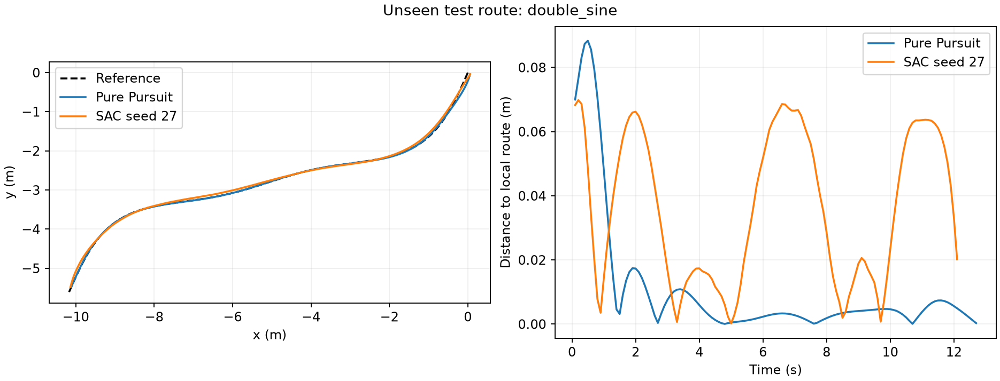

# Kinesis

**Simulated mobile-robot path tracking with Pure Pursuit and Soft Actor-Critic.**

A portfolio and learning project by Ankit Prajapati. It implements a validated 2D
simulator, integrates a conventional controller and Stable-Baselines3 SAC, and
evaluates both on held-out routes under shared constraints.

## Measured result

All controllers completed the 24 nominal test routes. **Pure Pursuit was the
stronger default for this simulator and budget:** it had lower tracking error,
command slew and measured CPU inference cost. SAC learned completion but did not
improve the full metric set.

| Nominal metric | Pure Pursuit | SAC across three training seeds |
| --- | ---: | ---: |
| Success | 24/24 | 24/24 for every seed |
| Tracking RMSE | 0.043 m | 0.113 +/- 0.066 m |
| Angular command slew RMS | 0.59 rad/s^2 | 5.91 +/- 2.18 rad/s^2 |
| Mean episode median inference | 0.032 ms | 0.390 +/- 0.058 ms |

SAC values are mean +/- sample standard deviation across three seeds, not confidence
intervals. Under a 200 ms command delay, Pure Pursuit completed 24/24 attempts;
SAC completed 65/72. All 384 test attempts, including seven failures, are retained.

Read [the complete results](docs/results.md) for time, family-specific outcomes,
all stress conditions, individual seeds and limitations.

## Run the finished project

The GitHub development container installs Python 3.12 and recorded CPU dependencies.
For an existing Linux x86_64 checkout:

~~~bash
bash .devcontainer/setup.sh
source .venv/bin/activate
python -m pytest
python -m kinesis.demo --controller pure_pursuit
python -m kinesis.demo --controller sac
~~~

The demos save a trajectory and figure under artifacts/demo/. The supplied SAC
demo uses seed 27, chosen on validation before test evaluation. All three trained
checkpoints and hashes are under [models/](models/).

No GPU is required. A fresh virtual environment was installed independently:
its package versions matched requirements.txt and all 26 checks passed.
The CPU-only Torch installation is recorded separately in requirements-cpu.txt.

## Reproduce the experiments

~~~bash
python -m kinesis.experiments pipeline \
  --pilot-steps 12000 --final-steps 80000 \
  --output-dir artifacts/reproduction
~~~

This preserves the recorded study. It runs four SAC pilot configurations, selects
on validation, trains three new random seeds, freezes selection and then evaluates
held-out scenarios. Existing completed test directories are not overwritten.
Numerical and hardware differences can affect training; pins do not guarantee
bitwise identical policies.

The recorded final learning calls used 11.13 minutes in total on two cloud vCPUs
with one PyTorch thread. This excludes pilots, evaluation, setup and documentation.
Full training/evaluation records are in [artifacts/](artifacts/).

## Implemented scope

- Bounded linear-speed and turn-rate commands.
- Planar kinematics with first-order motion response and integration substeps.
- Local projection and ordered waypoint gates.
- Gymnasium environment with observed command-delay queues.
- Pure Pursuit and the library's trained SAC policy.
- Disjoint manifests and a held-out double-sine route family.
- Paired noise, delay and changed-response stress tests.
- Completion, tracking, command-slew and measured inference metrics.

**SAC is supplied by Stable-Baselines3/PyTorch; it is not implemented from scratch.**
This version has no physical robot, motorcycle dynamics, ROS2 integration, embedded
deployment or real-world safety validation. Three seeds and a small fixed test set
provide limited evidence. Separate stress tests do not establish robustness to
combined disturbances.

Training uses source checkpoint 0df854a866d30330ba32dad38c29c9d8410ea1cc.
Later commits add reporting, demos, documentation and additional checks.
Large intermediate traces and scratch files remain in the Codespace.
