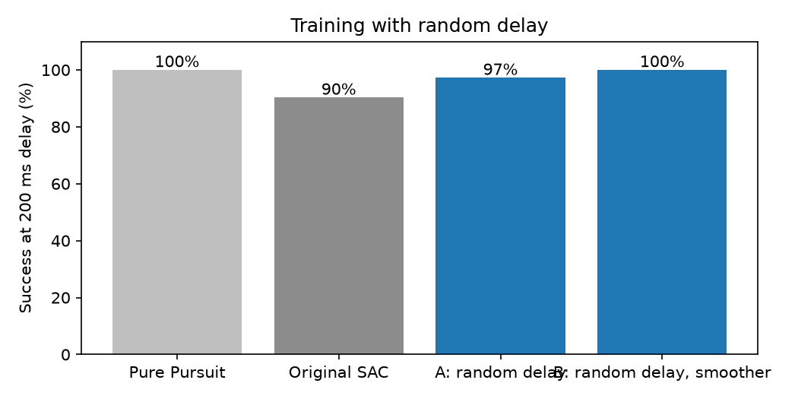
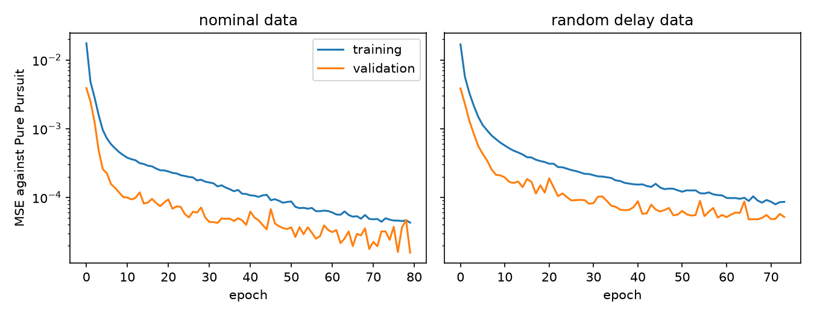

# Kinesis experimental results

Ankit Prajapati | Simulated mobile-robot path tracking | 28 October 2026

## Scope

A bounded planar simulator compares Pure Pursuit with Stable-Baselines3 SAC. This is a simulation study with no physical robot or embedded deployment.

## Protocol

- Training source checkpoint: 0df854a866d30330ba32dad38c29c9d8410ea1cc.
- Python 3.12.11; CPU PyTorch 2.14.1; Stable-Baselines3 2.9.2; Gymnasium 1.4.0.
- Cloud hardware: 2 vCPUs, approximately 8 GiB RAM; AMD EPYC 7763 host CPU.
- 24 training, 12 validation and 24 test scenarios; route hashes check exact split overlap.
- Training/validation use straight, sine and arc routes. Double-sine geometry is held out.
- Four candidates per method; SAC pilots use 12,000 steps each, seed 101.
- Three final SAC models use 80,000 steps each, independent seeds 7, 17 and 27.
- Candidate counts and validation scenarios match; computational tuning costs do not.
- Selected Pure Pursuit: {'lookahead': 0.8, 'cruise_speed': 1.0}.
- Selected SAC: {'learning_rate': 0.0003, 'ent_coef': 'auto_0.1'}.
- All controllers share observations, action limits and route-specific time allowances.
- Ordered 0.5 m gates with 0.35 m tolerance prevent skipped routes from counting as success.

## Nominal held-out results

All models use the same 24 test scenarios. SAC values are mean +/- sample standard deviation across three training seeds, not confidence intervals.

| Metric | Pure Pursuit | SAC across three seeds |
| --- | ---: | ---: |
| Success (%) | 100.0 | 100.0 +/- 0.0 |
| Ordered gate completion (%) | 100.0 | 100.0 +/- 0.0 |
| Tracking RMSE (m) | 0.043 | 0.113 +/- 0.066 |
| Maximum error, episode mean (m) | 0.184 | 0.278 +/- 0.136 |
| Elapsed time, all attempts (s) | 12.65 | 12.24 +/- 1.02 |
| Linear command slew RMS (m/s^2) | 0.88 | 1.23 +/- 0.10 |
| Angular command slew RMS (rad/s^2) | 0.59 | 5.91 +/- 2.18 |
| Mean episode median inference (ms) | 0.032 | 0.390 +/- 0.058 |
| Mean episode p95 inference (ms) | 0.058 | 0.595 +/- 0.155 |

Errors and elapsed times include early failures. Low values on short failed attempts do not demonstrate better control.

| SAC model | Successes / 24 | RMSE (m) | Paired successes | PP time (s) | SAC time (s) |
| --- | ---: | ---: | ---: | ---: | ---: |
| SAC seed 7 | 24 | 0.188 | 24 | 12.65 | 13.33 |
| SAC seed 17 | 24 | 0.090 | 24 | 12.65 | 11.33 |
| SAC seed 27 | 24 | 0.062 | 24 | 12.65 | 12.05 |

## Stress tests

Nominally trained models face one disturbance at a time. Each condition uses the same routes and initial states for every controller.

| Condition | PP success (%) | SAC success (%) | PP RMSE (m) | SAC RMSE (m) |
| --- | ---: | ---: | ---: | ---: |
| nominal | 100.0 | 100.0 +/- 0.0 | 0.043 | 0.113 +/- 0.066 |
| noise | 100.0 | 100.0 +/- 0.0 | 0.046 | 0.115 +/- 0.069 |
| delay_200ms | 100.0 | 90.3 +/- 8.7 | 0.059 | 0.175 +/- 0.085 |
| slow_response | 100.0 | 100.0 +/- 0.0 | 0.054 | 0.149 +/- 0.120 |

Noise: 0.03 m Gaussian position noise per coordinate and 3 degree heading noise. Delay: two 0.1 s control steps with observed command queue. Slow response: both time constants multiplied by 2.5. Noise does not simulate full localization.

## Held-out route family

| Nominal route family | PP success (%) | SAC success (%) | PP RMSE (m) | SAC RMSE (m) |
| --- | ---: | ---: | ---: | ---: |
| straight | 100.0 | 100.0 +/- 0.0 | 0.046 | 0.110 +/- 0.068 |
| sine | 100.0 | 100.0 +/- 0.0 | 0.053 | 0.117 +/- 0.064 |
| arc | 100.0 | 100.0 +/- 0.0 | 0.036 | 0.112 +/- 0.068 |
| double_sine | 100.0 | 100.0 +/- 0.0 | 0.036 | 0.114 +/- 0.066 |

Each family has six test scenarios, a small sample.

## Failure records

| Controller | Condition | Failure reasons |
| --- | --- | --- |
| Pure Pursuit | nominal | none |
| SAC seed 7 | nominal | none |
| SAC seed 17 | nominal | none |
| SAC seed 27 | nominal | none |
| Pure Pursuit | noise | none |
| SAC seed 7 | noise | none |
| SAC seed 17 | noise | none |
| SAC seed 27 | noise | none |
| Pure Pursuit | delay_200ms | none |
| SAC seed 7 | delay_200ms | none |
| SAC seed 17 | delay_200ms | missed_gate: 4 |
| SAC seed 27 | delay_200ms | missed_gate: 2, time_limit: 1 |
| Pure Pursuit | slow_response | none |
| SAC seed 7 | slow_response | none |
| SAC seed 17 | slow_response | none |
| SAC seed 27 | slow_response | none |

## Resources and interpretation

Final training used 11.13 minutes summed over three learning calls. This excludes pilots, evaluation, setup and documentation. No GPU was used.

- Three seeds give limited evidence about variability. No significance or universal superiority claim is made.
- Reference previews and localization are simplified; the scenario distribution is finite.
- Stresses are tested separately. Combined disturbances were not evaluated.
- Episode latency percentiles are averaged, not pooled over all calls.
- Latency is CPU wall time around prediction, not an embedded deadline or worst-case guarantee.
- Wheel dynamics, slip, obstacles, collisions, physical sensing and safety validation are outside scope.
- Selection was frozen before testing; test outcomes do not feed tuning.

## Evidence

- artifacts/protocol.json and manifests/: budgets, versions, source checkpoint, cases and route hashes.
- baseline_selection.json and sac_selection.json: all validation candidates.
- training/seed_*/run.json and monitor.csv: each final training record.
- test_episodes.csv and test_results.json: all test attempts, including failures.
- figures/: fixed examples and training-return plots.

SAC: https://stable-baselines3.readthedocs.io/en/master/modules/sac.html
Pure Pursuit: https://publications.ri.cmu.edu/implementation-of-the-pure-pursuit-path-tracking-algorithm

## Follow-up (November 2026): delay-randomised training

Question: does training with random command delay make SAC robust to a 200 ms delay?

Decided before testing: variant A draws a delay of 0, 100 or 200 ms for each training episode; variant B also raises the action-change penalty from 0.02 to 0.2. Both use the original seeds (7, 17, 27), 80,000 steps, SAC settings and 24 test routes. Both variants are reported, and the sections above are unchanged.

| Model | Nominal success | Nominal RMSE (m) | Nominal angular slew RMS (rad/s^2) | 200 ms success | 200 ms RMSE (m) | 200 ms angular slew RMS (rad/s^2) |
| --- | ---: | ---: | ---: | ---: | ---: | ---: |
| Pure Pursuit | 24/24 | 0.043 | 0.59 | 24/24 | 0.059 | 0.92 |
| Original SAC | 72/72 | 0.113 +/- 0.066 | 5.91 +/- 2.18 | 65/72 | 0.175 +/- 0.085 | 8.29 +/- 0.26 |
| A: random delay | 72/72 | 0.092 +/- 0.005 | 9.43 +/- 4.04 | 70/72 | 0.141 +/- 0.097 | 9.75 +/- 4.22 |
| B: random delay, stronger smoothing | 72/72 | 0.094 +/- 0.045 | 4.87 +/- 2.89 | 72/72 | 0.082 +/- 0.007 | 3.34 +/- 1.90 |

SAC rows are mean +/- sample standard deviation across three seeds; success counts are summed over seeds.

| Variant | Seed | 200 ms successes / 24 | 200 ms RMSE (m) |
| --- | ---: | ---: | ---: |
| A | 7 | 22 | 0.254 |
| A | 17 | 24 | 0.088 |
| A | 27 | 24 | 0.083 |
| B | 7 | 24 | 0.075 |
| B | 17 | 24 | 0.090 |
| B | 27 | 24 | 0.082 |

Training with random delay removed most of SAC's failures under a 200 ms delay: variant A succeeded in 70 of 72 attempts and variant B in all 72, against 65 for the original policies. Variant B also tracked more closely under delay (0.082 m against 0.175 m) and steered more smoothly than the original SAC, while variant A's steering became jerkier. Pure Pursuit remains more precise and much smoother in nominal conditions; with three seeds the difference between A and B is small, so next I would add seeds, test combined disturbances and delays outside the training range, and try a learned residual on top of Pure Pursuit.

Limits: the 200 ms test delay lies inside the training range, so this measures robustness to a disturbance seen in training, not to unseen ones. The follow-up script saves summaries only, so the reasons for variant A's two failed attempts were not recorded.

Evidence: artifacts/delay_study/summary.json holds all 12 evaluations, with one model.zip per variant and seed. delay_study.py trains and evaluates them; delay_report.py prints the comparison and draws delay_success.png.

## Follow-up 2 (November 2026): imitation learning with TensorFlow/Keras

Question: can a network the size of SAC's actor copy Pure Pursuit from demonstrations, and does it need delay in its training data?

Decided before testing: a Keras network (25 inputs, two hidden layers of 64, tanh output; 5,954 parameters) is trained with mean squared error to reproduce the frozen Pure Pursuit's actions. Demonstrations come from the 24 training routes, with one clean and three noisy rollouts per route; noisy rollouts execute the expert action plus Gaussian noise (standard deviation 0.2) but keep the clean expert action as the label. The 12 validation routes give the validation set for early stopping (patience 8, at most 80 epochs). Variant `nominal_data` collects demonstrations without delay; `random_delay_data` draws a delay of 0, 100 or 200 ms for each episode. Each variant uses one training seed (0), with TensorFlow 2.21.0 and Keras 3.15.1.

| Controller | Nominal success | Nominal RMSE (m) | Nominal angular slew RMS (rad/s^2) | 200 ms success | 200 ms RMSE (m) | 200 ms elapsed time (s) |
| --- | ---: | ---: | ---: | ---: | ---: | ---: |
| Pure Pursuit (the expert) | 24/24 | 0.043 | 0.59 | 24/24 | 0.059 | 12.99 |
| Keras copy, nominal data | 24/24 | 0.043 | 0.59 | 24/24 | 0.082 | 16.23 |
| Keras copy, random-delay data | 24/24 | 0.044 | 0.61 | 24/24 | 0.059 | 12.95 |
| SAC, main study (three seeds) | 72/72 | 0.113 +/- 0.066 | 5.91 +/- 2.18 | 65/72 | 0.175 +/- 0.085 | 15.06 +/- 3.38 |

The Keras network copied Pure Pursuit closely: it completed all 24 test routes in both conditions, and its nominal error and steering slew matched the expert's. SAC's actor has the same hidden size yet steered about ten times more abruptly, which suggests that SAC's jerky steering came from how it was trained rather than from network capacity. Without delay in its demonstrations, the copy's error under a 200 ms delay rose to 0.082 m and routes took 16.2 s instead of 13.0 s; with random delays in the data, it matched the expert. This repeats the delay study's lesson: inputs that never varied in training are a risk when they change.

Limits: a copy is bounded by its expert, so this shows learning from demonstrations, not better control. Each variant uses one training seed, and the 200 ms test delay lies inside the random-delay variant's training range. Median inference through TensorFlow was 0.44–0.48 ms per step, against 0.03 ms for Pure Pursuit. The TensorFlow Lite export is 25.5 KB; its timing on an embedded device was not measured.

Evidence: artifacts/keras_imitation/ holds summary.json, loss_curves.png, both .keras models and random_delay_data.tflite. keras_imitation.py reproduces them in the environment described in requirements-tf.txt.
